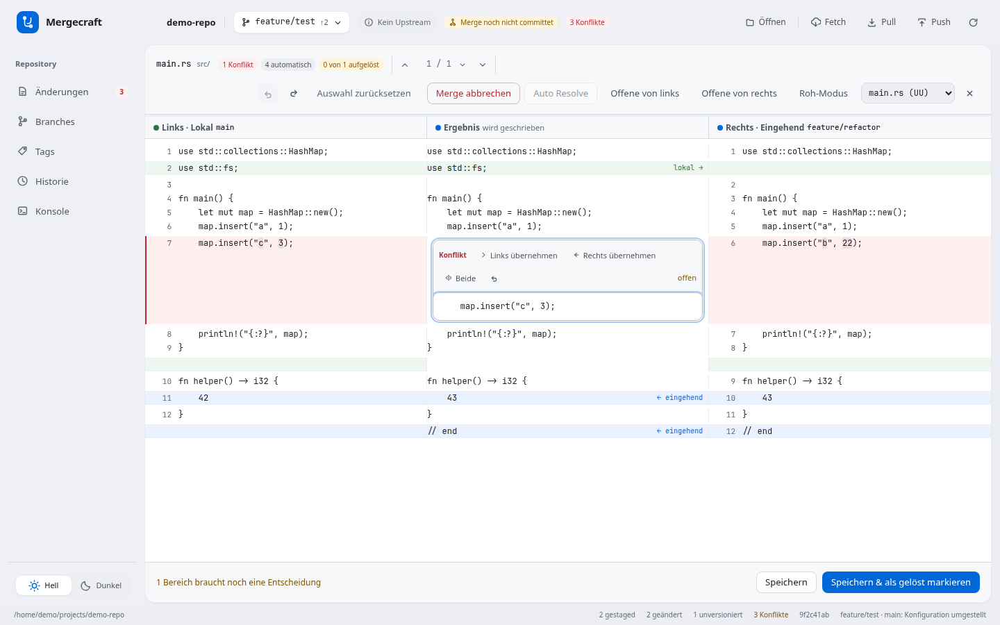

<p align="center">
  
</p>

<h1 align="center">Mergecraft</h1>
<p align="center">A focused Git desktop client for Linux.<br>Review changes, navigate branches, and resolve merge conflicts in one calm workspace.</p>

<p align="center">
  <a href="https://github.com/Mohr90/mergecraft/actions/workflows/ci.yml"></a>
  <a href="LICENSE"></a>
  
  
</p>

<p align="center">
  <a href="https://github.com/Mohr90/mergecraft/releases">Downloads</a> ·
  <a href="docs/guide.de.md">Deutsche Anleitung</a> ·
  <a href="CONTRIBUTING.md">Contributing</a> ·
  <a href="https://github.com/Mohr90/mergecraft/issues">Report a bug</a>
</p>

<picture>
  <source media="(prefers-color-scheme: dark)" srcset="docs/screenshots/mergecraft-apple-dark.png">
  
</picture>

## Your repository, clearly organized

| Workspace | What you can do |
| --- | --- |
| **Changes** | Review inline diffs, select files with staging checkboxes, create commits, amend the last commit, or roll back selected tracked files to HEAD. |
| **Branches** | Search, filter and sort favorites, local branches and remote branches. Create, switch, compare and merge branches. |
| **Merge editor** | Compare local, result and incoming text side by side. Accept either side or both, review automatic proposals, edit the result, and undo decisions. |
| **Tags & history** | Browse tags and commits, inspect changed files, compare revisions and follow a file's history. |
| **Remotes** | Fetch, pull and push using your existing Git configuration and credential helpers. See unpublished commits and incoming changes. |

The interface supports **German and English**. Switch languages using the labeled flag buttons beside the appearance controls; your choice is saved locally. Without a saved preference, Mergecraft uses a supported system language and otherwise falls back to English. Light/dark appearance is a separate preference. Mergecraft uses the real Git CLI, so it works with GitHub, GitLab and other Git remotes. It does not require a hosting-service API token and does not provide a built-in merge-request or pipeline dashboard.

## German or English


Switch immediately between **Deutsch** and **English** without reopening the repository. Drafts, filters, staging selections and merge-editor text/history stay in place. Dates and app-generated messages follow the selected language; your repository content and raw Git output are preserved.

## Resolve conflicts with context



- **Accept local, incoming, or both** for an individual conflict; bulk actions preserve existing decisions.
- **Auto Resolve** proposes compatible edits, including simple independent changes within a line or across multiple lines. Review each proposal before accepting it; overlapping and ambiguous edits stay manual.
- **Undo / redo** decisions and text edits, or reset the current file's preview.
- **Save** writes the result. **Save and mark resolved** also stages it. Unresolved conflict markers prevent marking a file resolved.
- **Abort merge** uses `git merge --abort` for the running merge, including previously saved conflict resolutions. It does not rewrite completed merge commits. Git may be unable to reconstruct the original state if local changes existed before the merge.
- Binary and non-UTF-8 files are handled as whole-side choices. Modify/delete conflicts also support deletion.

## Review before you commit


A new commit needs staged files. Missing selections are explained beside the commit controls. **Amend** remains an explicit option. Commit drafts survive refreshes and navigation and clear only after a successful commit.

Remote checkout also has an explicit choice when a local branch already exists: open its current state, or fast-forward it to the remote state. Automatic updates require a clean worktree and preserve local commits. Pull can offer to connect a unique same-name remote when tracking has not been configured.

Synchronization indicators compare commits against the **last fetched remote references**; use Fetch to refresh them. Uncommitted changes are separate from this status. Local merges into `main` and `master` are intentionally hidden in the GUI; the intended workflow uses a merge/pull request on the hosting service. Merging `master` into a checked-out feature branch is supported.

## Install on Linux

Mergecraft currently targets Linux with GTK 3 and WebKitGTK 4.1. Windows and macOS builds are not currently supported by the native implementation.

Download the `.deb` package from [Releases](https://github.com/Mohr90/mergecraft/releases), then install it on a compatible Debian/Ubuntu system:

```bash
sudo apt install ./Mergecraft_0.2.0_amd64.deb
mergecraft /path/to/repository
```

Or build from source and install for your user without `sudo`:

```bash
git clone https://github.com/Mohr90/mergecraft.git
cd mergecraft
npm ci
npm run build -- --bundles deb
bash packaging/install.sh
```

See [development prerequisites and tests](CONTRIBUTING.md) before building. The native app requires Git in `PATH` and uses your existing SSH keys or Git credential helper. Keep credentials in Git's normal credential tooling.

## Try the interface

```bash
npm ci
npm run dev:web
```

Open the local URL shown by Vite. Browser mode uses synthetic demo data and does not operate on a real repository. All screenshots in this README were captured in that demo/test mode; they contain no private repository data.

For the native application:

```bash
npm run dev
```

## Use as an external merge tool

```bash
mergecraft --merge <local> <base> <incoming> <result> [local-label] [incoming-label]
```

Optional Git configuration:

```bash
git config --global merge.tool mergecraft
git config --global mergetool.mergecraft.cmd \
  'mergecraft --merge "$LOCAL" "$BASE" "$REMOTE" "$MERGED"'
git config --global mergetool.mergecraft.trustExitCode true
```

## Built with

**Rust + Tauri 2** for the native app and Git integration; **TypeScript + Vite** for the interface. UI messages use local translation catalogs; switching languages preserves commit drafts, Git staging, filters and unsaved merge edits. See the [i18n contributor guide](docs/i18n.md). The Rust core has randomized differential tests against `git merge-file`, regression tests and real-repository workflow tests. Browser tests cover the UI and mocked application flows; native fixtures exercise the actual Tauri/Git bridge.

```text
core/        Git integration, three-way merge engine and regression tests
src/         Desktop interface, diff viewer and merge editor
src-tauri/   Native application, commands and diagnostics
packaging/   User installation and desktop integration
scripts/     Development and test helpers
tests/       Browser and native workflow checks
docs/        User guide, development notes and demo screenshots
```

## License

[MIT](LICENSE) · Copyright © 2026 Steffen Mohr.
