<p align="center">
  
</p>

<h1 align="center">Mergecraft</h1>
<p align="center">A focused Git desktop client for Linux.<br>Review changes, navigate branches, and resolve merge conflicts in one calm workspace.</p>

<p align="center">
  <a href="https://github.com/Mohr90/mergecraft/actions/workflows/ci.yml"></a>
  <a href="LICENSE"></a>
  
  
</p>

<p align="center">
  <a href="https://github.com/Mohr90/mergecraft/releases">Downloads</a> ·
  <a href="docs/guide.de.md">Deutsche Anleitung</a> ·
  <a href="CONTRIBUTING.md">Contributing</a> ·
  <a href="https://github.com/Mohr90/mergecraft/issues">Report a bug</a>
</p>

<picture>
  <source media="(prefers-color-scheme: dark)" srcset="docs/screenshots/mergecraft-apple-dark.png">
  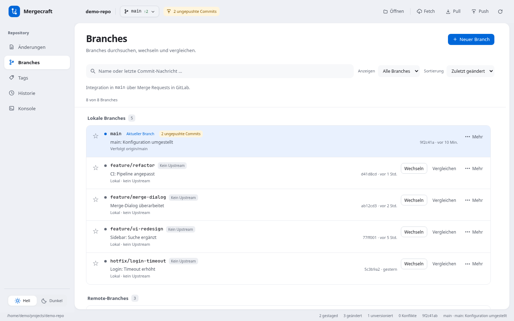
</picture>

## Your repository, clearly organized

| Workspace | What you can do |
| --- | --- |
| **Changes** | Review inline diffs, select files with staging checkboxes, create commits, amend the last commit, or roll back selected tracked files to HEAD. |
| **Branches** | Search, filter and sort favorites, local branches and remote branches. Create, switch, compare and merge branches. |
| **Merge editor** | Navigate conflict files, keep drafts and undo history while switching, resize the result pane, and review explainable automatic proposals. |
| **Tags & history** | Browse tags and commits, inspect changed files, compare revisions and follow a file's history. |
| **Remotes** | Fetch, pull and push using your existing Git configuration and credential helpers. See unpublished commits and incoming changes. |

The interface supports **German and English**. Switch languages using the labeled flag buttons beside the appearance controls; your choice is saved locally. Without a saved preference, Mergecraft uses a supported system language and otherwise falls back to English. Light/dark appearance is a separate preference. Mergecraft uses the real Git CLI, so it works with GitHub, GitLab and other Git remotes. It does not require a hosting-service API token and does not provide a built-in merge-request or pipeline dashboard.

## Read code and switch projects faster

Syntax colors in diffs and merge panes make keywords, strings, comments, numbers and recognizable function/type names easier to scan. Java, TypeScript/JavaScript, JSON, Rust, CSS, HTML/XML, Python and shell grammars are bundled locally. Git line/word highlights remain visible; unknown files and inputs over 200,000 characters or 6,000 lines use plain text. This is lexical highlighting, not semantic code analysis.

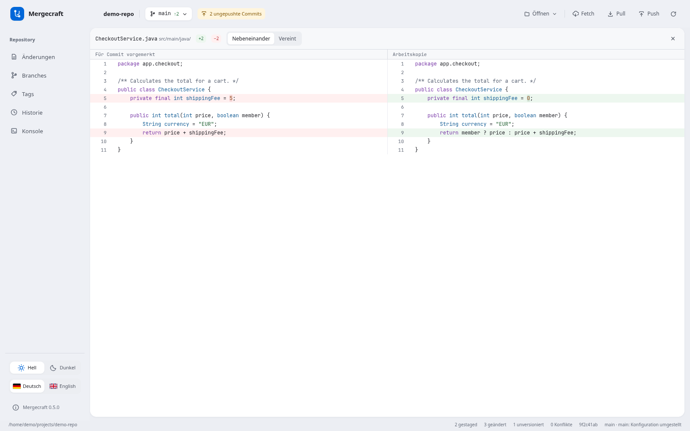

**Open** now includes pinned and recent repositories. Pin a project to keep it at the top; full paths distinguish matching names. Project pins persist locally. During an app session, returning to a repository restores its workspace, branch/tag filters and commit draft. Unsaved merge decisions still require confirmation before leaving. Switching projects does not discard Git changes.

<details>
<summary>See repository shortcuts and editable merge syntax colors</summary>

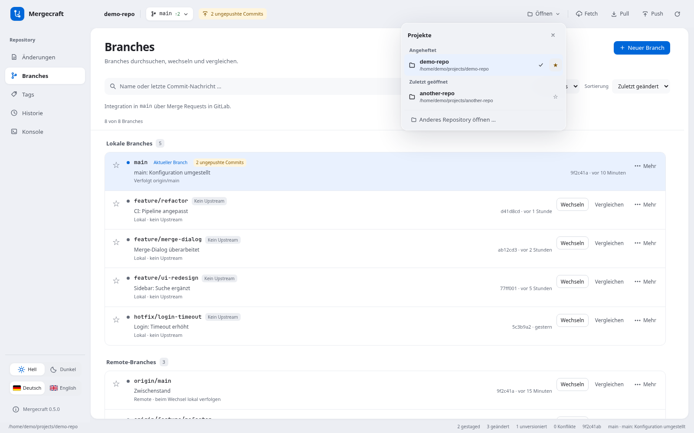
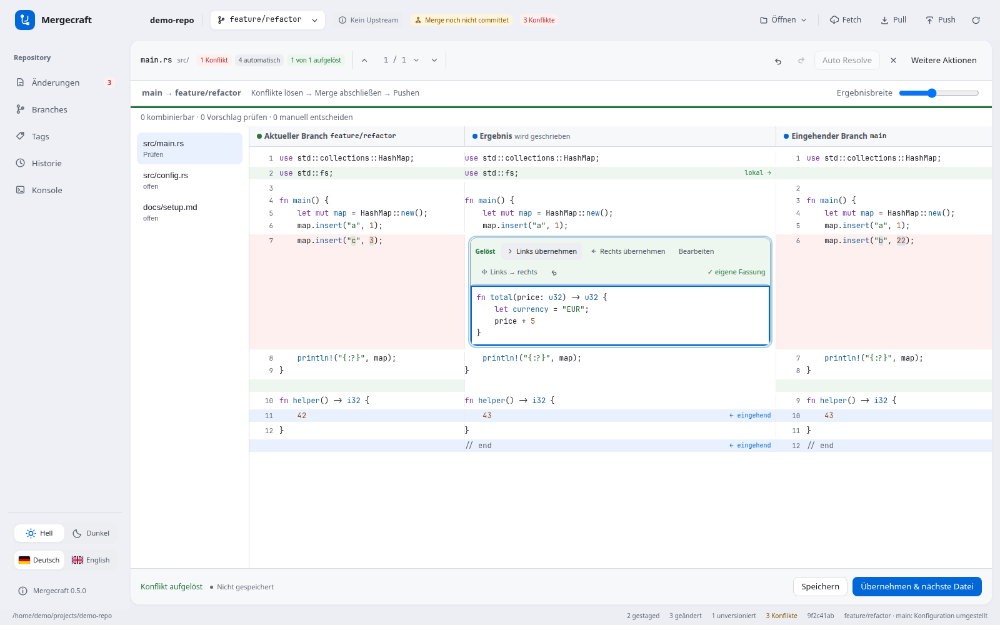

</details>

See the [versioned roadmap](docs/roadmap.md) for the v1.3.0 outgoing-commit and branch-history workflow.

## German or English

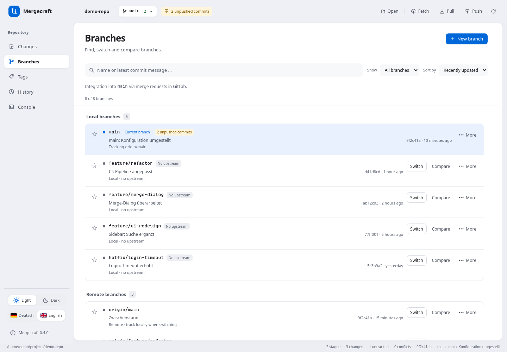

Switch immediately between **Deutsch** and **English** without reopening the repository. Drafts, filters, staging selections and merge-editor text/history stay in place. Dates and app-generated messages follow the selected language; your repository content and raw Git output are preserved.

## Follow a merge from conflict to push


**Incoming → current branch** stays visible above the three panes. The file list shows what remains open, what needs review and what is resolved. Give the result more space using the width control; decisions and text stay in place as you move between files.

- **Auto Resolve** previews combinations of separate text ranges and explains why they can be combined. Accepting a batch preserves existing decisions and can be undone in one step.
- **Review proposals** for independent edits within the same line individually. Overlaps and ambiguous edits require your decision. Automatic text combinations do not guarantee logically correct code.
- **Accept left, accept right, edit, or left → right** for a single conflict. The last option concatenates both versions in the stated order.
- **Save** keeps a partial result. **Apply & next file** saves and stages a resolved file. Conflict markers block resolution; stale worktree or index contents block overwriting external changes.
- **Undo / redo**, reset the file preview, or **abort the running merge**. Abort includes saved resolutions; it does not undo completed merge commits. Git can be unable to restore the original state if local changes existed before the merge.

Drafts and undo history are kept in memory for the current merge-editor session. Large conflict regions are analyzed in a background worker. Binary/non-UTF-8 files and modify/delete conflicts use explicit whole-side choices.

<details>
<summary>See the automatic preview and a proposal that needs review</summary>

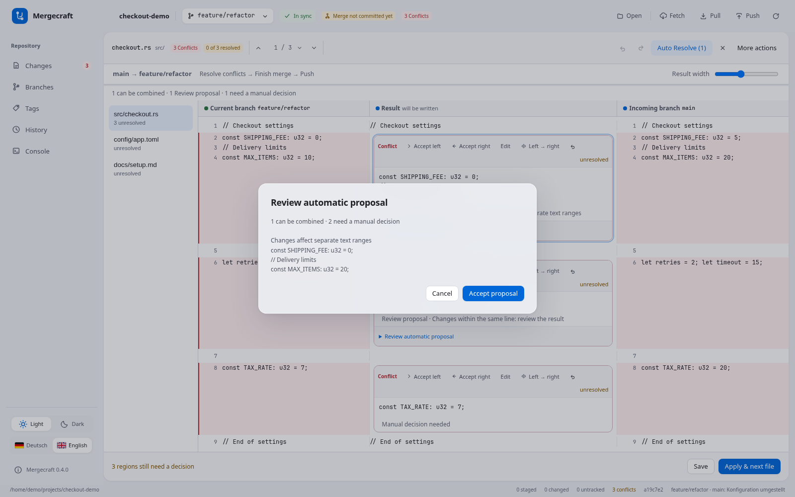

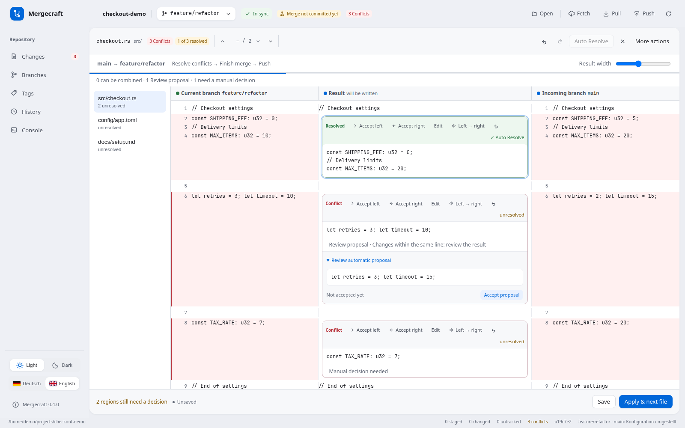

</details>

### Resolve → finish merge → push

Resolving files prepares the result. **Finish merge** creates the merge commit. **Push** sends committed changes to the remote. Each step stays visible so a local preview cannot be mistaken for a published change.

<details>
<summary>See the resolved result, merge completion and pending push</summary>

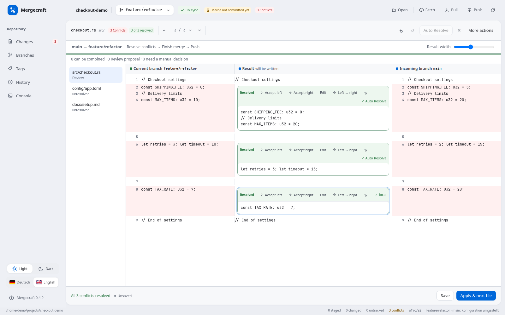

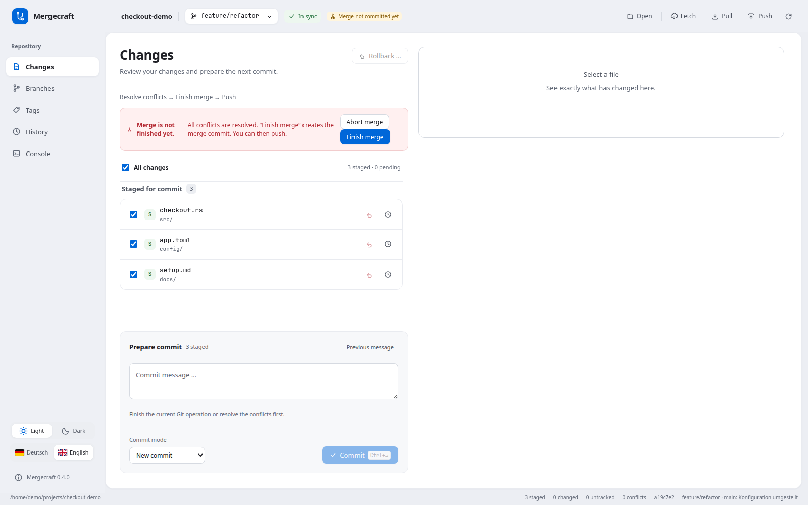

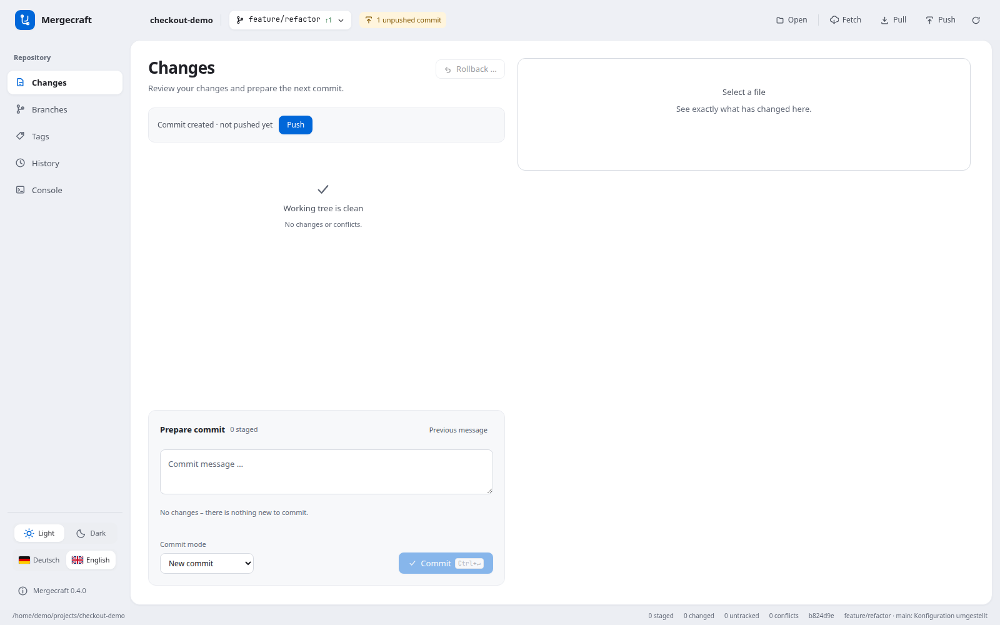

</details>

See the [merge workflow guide](docs/merging.md) for details.

## Review before you commit

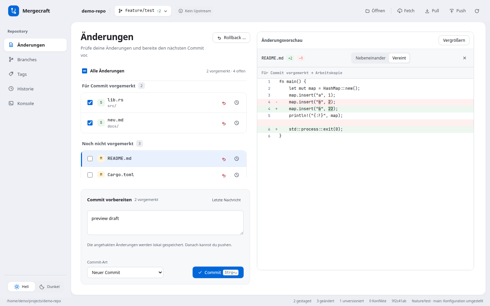

A new commit needs staged files. Missing selections are explained beside the commit controls. **Amend** remains an explicit option. Commit drafts survive refreshes and navigation and clear only after a successful commit.

Remote checkout also has an explicit choice when a local branch already exists: open its current state, or fast-forward it to the remote state. Automatic updates require a clean worktree and preserve local commits. Pull can offer to connect a unique same-name remote when tracking has not been configured.

Synchronization indicators compare commits against the **last fetched remote references**; use Fetch to refresh them. Uncommitted changes are separate from this status. Local merges into `main` and `master` are intentionally hidden in the GUI; the intended workflow uses a merge/pull request on the hosting service. Merging `master` into a checked-out feature branch is supported.

## Install on Linux

Mergecraft currently targets Linux with GTK 3 and WebKitGTK 4.1. Windows and macOS builds are not currently supported by the native implementation.

Download the `.deb` package from [Releases](https://github.com/Mohr90/mergecraft/releases), then install it on a compatible Debian/Ubuntu system:

```bash
sudo apt install ./Mergecraft_*.deb
mergecraft /path/to/repository
```

Or build from source and install for your user without `sudo`:

```bash
git clone https://github.com/Mohr90/mergecraft.git
cd mergecraft
npm ci
npm run build -- --bundles deb
bash packaging/install.sh
```

See [development prerequisites and tests](CONTRIBUTING.md) before building. The native app requires Git in `PATH` and uses your existing SSH keys or Git credential helper. Keep credentials in Git's normal credential tooling.

## Try the interface

```bash
npm ci
npm run dev:web
```

Open the local URL shown by Vite. Browser mode uses synthetic demo data and does not operate on a real repository. Screenshots use synthetic demo data: the v0.5.0 syntax/project features and the v0.4.0 conflict-resolution tour. They contain no private repository data. The source version on `main` may be newer than the latest downloadable release.

For the native application:

```bash
npm run dev
```

## Use as an external merge tool

```bash
mergecraft --merge <local> <base> <incoming> <result> [local-label] [incoming-label]
```

Optional Git configuration:

```bash
git config --global merge.tool mergecraft
git config --global mergetool.mergecraft.cmd \
  'mergecraft --merge "$LOCAL" "$BASE" "$REMOTE" "$MERGED"'
git config --global mergetool.mergecraft.trustExitCode true
```

## Version information

The footer shows the installed version. Click it to see whether a newer version is available and open the GitHub project. Version checks do not modify your installation; updates are installed manually. See the [release guide](docs/releases.md).

## Built with

**Rust + Tauri 2** for the native app and Git integration; **TypeScript + Vite** for the interface. UI messages use local translation catalogs; switching languages preserves commit drafts, Git staging, filters and unsaved merge edits. See the [i18n contributor guide](docs/i18n.md). The Rust core has randomized differential tests against `git merge-file`, regression tests and real-repository workflow tests. Browser tests cover the UI and mocked application flows; native fixtures exercise the actual Tauri/Git bridge.

```text
core/        Git integration, three-way merge engine and regression tests
src/         Desktop interface, diff viewer and merge editor
src-tauri/   Native application, commands and diagnostics
packaging/   User installation and desktop integration
scripts/     Development and test helpers
tests/       Browser and native workflow checks
docs/        User guide, development notes and demo screenshots
```

## License

[MIT](LICENSE) · Copyright © 2026 Steffen Mohr.
