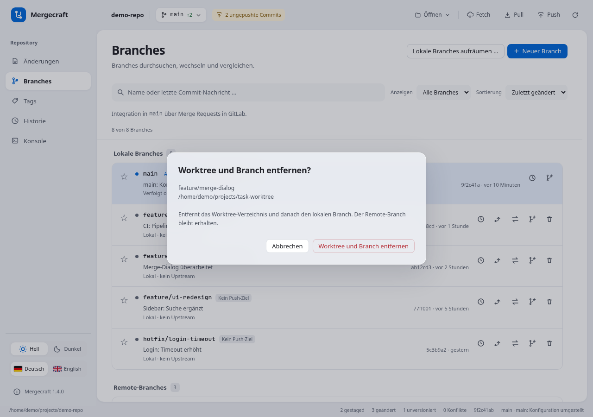

# Safer Git workflows (v1.4.0)

## Merge preview

Select Merge on a source branch. The sheet names `source → current branch`, counts incoming commits, lists files changed in the simulated merge result and marks conflict paths. Select a file to inspect the simulated result against the current commit. Conflict markers in this temporary result are intentional. Nothing has been applied to your working copy yet.

Cancel closes the preview and cancels background analysis. Start merge rechecks branch tips, index and working-copy state; changed state requires opening a fresh preview. A dirty worktree or running Git operation blocks the action. Older Git installations that lack `merge-tree --write-tree` receive an explicit error. No implicit fetch occurs. Analysis has a 60-second limit and does not run on the GUI thread.

## Stage individual blocks

Select a changed file. In its diff, each complete hunk has Stage hunk (working copy) or Unstage hunk (staged diff). The operation changes only the index; your working file is preserved. A mixed file checkbox identifies partial staging. Checking it stages the remaining file changes; unchecking a checked file unstages it. Refreshes preserve the commit message.

Untracked files are staged as a whole first. Binary files, renames, mode changes, oversized patches and running Git operations use explicit whole-file actions. No partial rollback is offered. External content/index changes invalidate the hunk token, so stale displayed patches cannot be applied.

## Revert a commit

In History, select an ordinary single-parent commit reachable from your current branch and choose Revert commit. The sheet shows the destination branch, affected files and the selected commit's reverse diff. This is not a promise that later edits can be applied without conflict.

Create revert commit prepares the inverse changes and creates a new commit with normal commit hooks. A clean worktree is required. On conflicts or hook failures, the operation stays visible under Changes: resolve files, then Finish revert, or Abort revert to restore the pre-operation state. Empty reverts explain that there is nothing to commit and can be aborted. Nothing is pushed automatically; the outgoing-commit indicator shows the new local commit.

This first version handles one ordinary commit at a time. Merge commits require choosing a mainline and are intentionally not offered. Revert differs from file Rollback: Rollback discards uncommitted tracked-file changes, while Revert records an inverse change as a new commit.

## Remove a branch checked out in a worktree (unreleased)

Use the branch's Delete action. If it is checked out in one linked worktree, Mergecraft offers **Remove worktree and branch**, showing the full directory path and any warning about commits unique to that branch. Confirming removes the directory through Git, then deletes the local branch. Remote branches are preserved.

Main/current, locked, missing, busy, submodule and multiple-worktree cases are protected. Tracked modifications, untracked files and even ignored files block deletion; Mergecraft never forces worktree removal. If the repository changes after confirmation, reopen the action. If Git removes the worktree but subsequently refuses branch deletion, the error explicitly says that the branch remains. Bulk cleanup continues to protect checked-out branches.

