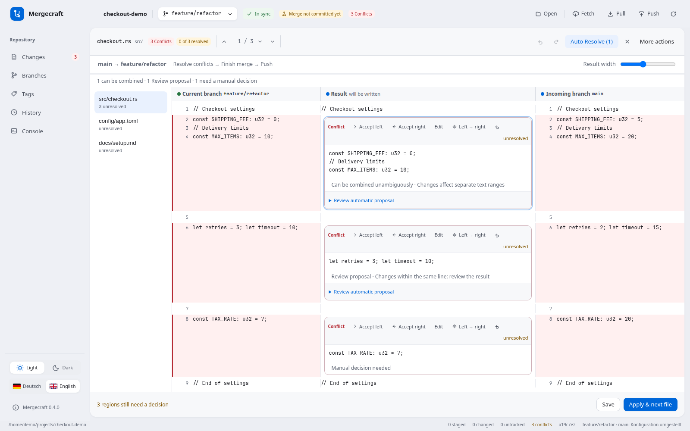

# Mergecraft bedienen

Mergecraft ist ein Git-Client für Linux. Die Oberfläche ist auf Deutsch und Englisch verfügbar, Git-Zugangsdaten und Remote-Konfiguration kommen aus deiner vorhandenen Git-Einrichtung.

## Sprache und Darstellung

Unten in der Seitenleiste stehen beim Hell-/Dunkel-Schalter zwei beschriftete Sprachbuttons: **🇩🇪 Deutsch** und **🇬🇧 English**. Die aktive Sprache ist markiert und bleibt lokal gespeichert. Ohne eigene Auswahl folgt die App einer unterstützten Systemsprache; andernfalls startet sie auf Englisch.

Der Wechsel lädt kein Repository neu und verändert weder Dateien noch den Git-Index. Commit-Entwürfe, Filter, Merge-Entscheidungen, freie Texte und Undo/Redo bleiben erhalten. Git-Ausgaben, Dateinamen, Branch-Namen, Commit-Nachrichten und Quelltext werden nicht übersetzt. Die Sprache lässt sich auch auf der Willkommensseite und im externen Merge-Tool ändern.

## Änderungen und Commit

1. Öffne ein Repository und wähle **Änderungen**.
2. Klicke auf eine Datei, um den Diff zu prüfen.
3. Hake die gewünschten Dateien an. Der Haken bedeutet: für den Commit vorgemerkt.
4. Gib eine Nachricht ein und wähle **Commit**. **Push** veröffentlicht anschließend die Commits.

Ohne vorgemerkte Dateien bleibt „Neuer Commit“ deaktiviert. **Letzten Commit ändern (Amend)** ist eine bewusste Alternative, etwa zum Ändern der Nachricht. Damit wird der letzte Commit ersetzt; bei bereits veröffentlichten Commits ist der weitere Push von deiner Git-Konfiguration und den Remote-Regeln abhängig.

**Rollback** setzt ausgewählte getrackte Dateien auf HEAD zurück und verwirft deren lokale Änderungen. Es wird dabei kein Stash angelegt. Neue, ungetrackte Dateien haben eine eigene Löschaktion.

## Branches und Remote

Favoriten, lokale Branches und Remote-Branches sind getrennt dargestellt. Suche und Filter bleiben beim Aktualisieren erhalten. **Vergleichen** zeigt die Unterschiede zweier Commit-Spitzen, ohne die Arbeitskopie zu ändern.

Beim Wechsel zu einem Remote-Branch wird ein lokaler Tracking-Branch angelegt. Existiert dieser bereits, kannst du ihn öffnen oder per Fast-forward auf den Remote-Stand aktualisieren. Eigene lokale Commits werden bei dieser Aktualisierung nicht verworfen; offene Dateiänderungen blockieren sie. Für einen verlorenen lokalen Stand gibt es keinen automatischen Reset.

**Fetch** aktualisiert die bekannten Remote-Referenzen. **Pull** übernimmt Änderungen des zugeordneten Upstreams. Fehlt diese Zuordnung, kann ein eindeutig gleichnamiger Remote-Branch nach Rückfrage verbunden werden. „Synchron“ bezieht sich auf Commits und den zuletzt bekannten Remote-Stand; lokale Dateiänderungen zählen dort nicht mit.

## Mergen und Konflikte lösen

Checke zuerst den Zielbranch aus. Wähle dann beim Quellbranch **Mergen**, etwa `origin/master` in deinem Feature-Branch. Direkte lokale Merges nach `main` oder `master` werden in der GUI bewusst nicht angeboten; dafür ist ein Merge Request bzw. Pull Request auf dem Server vorgesehen.

Bei Konflikten zeigt der Editor **Aktueller Branch · Ergebnis · Eingehender Branch**. Die Richtung steht darüber, etwa `main → feature/refactor`. Links kannst du zwischen Konfliktdateien wechseln; Entscheidungen, Text, Scrollposition und Undo-Verlauf bleiben während dieser Editor-Sitzung erhalten. Über **Ergebnisbreite** passt du die Spalten an.



**Auto Resolve** unterscheidet eindeutig kombinierbare Textbereiche, prüfpflichtige Vorschläge und manuelle Entscheidungen. Die Vorschau erklärt die Kombination. Änderungen innerhalb derselben Zeile übernimmst du einzeln nach Prüfung. Das Ergebnis muss weiterhin fachlich geprüft werden.

- **Links übernehmen**, **Rechts übernehmen** oder **Bearbeiten** entscheidet einen Bereich. **Links → rechts** hängt beide Fassungen in dieser Reihenfolge aneinander.
- **Rückgängig/Wiederholen** gilt für Entscheidungen und Texte. Ein Auto-Resolve-Durchlauf lässt sich in einem Schritt zurücknehmen.
- Unter **Weitere Aktionen** findest du das Zurücksetzen der Datei-Vorschau und **Merge abbrechen**.
- **Speichern** schreibt einen Zwischenstand. **Übernehmen & nächste Datei** speichert und markiert die Datei mit `git add` als gelöst.
- Extern geänderte Datei- oder Indexstände werden beim Speichern erkannt. Ein veralteter Entwurf wird erst nach deiner Entscheidung ersetzt.
- Nach allen Konflikten erstellt **Merge abschließen** den Merge-Commit. Danach zeigt die App den noch ausstehenden **Push** an.
- **Merge abbrechen** ruft `git merge --abort` auf und betrifft auch gespeicherte Auflösungen des laufenden Merges. Bereits abgeschlossene Merge-Commits werden damit nicht rückgängig gemacht. Vorher vorhandene lokale Änderungen können Git die Wiederherstellung erschweren.

Die Screenshots verwenden ausschließlich Demo-Daten. Weitere Schritte sind im [Merge-Leitfaden](merging.md) beschrieben.

## Tastatur

| Kürzel | Aktion |
| --- | --- |
| Strg+1 / 2 / 3 / 4 / 5 | Änderungen / Branches / Historie / Konsole / Tags |
| Strg+P | Branch-Suche |
| Strg+R oder F5 | Aktualisieren |
| Strg+Enter | Commit aus dem Nachrichtenfeld |
| Alt+↑ / Alt+↓ | Vorheriger / nächster Konflikt |
| Alt+← / Alt+→ / Alt+B | Lokal / eingehend / beide übernehmen |
| Alt+Enter | Speichern und als gelöst markieren |
| Strg+Z / Strg+Umschalt+Z | Rückgängig / Wiederholen im Merge-Editor |
| Esc | Menü oder Ansicht schließen; ungespeicherte Merge-Texte werden geschützt |

## Diagnose

```bash
mergecraft --diag /pfad/zum/repo
mergecraft --diag /pfad/zum/repo src/main.rs
```

Die Diagnose kann Dateinamen, Commit-Texte und Remote-Adressen enthalten. Prüfe die Ausgabe, bevor du sie in einem öffentlichen Issue teilst.
