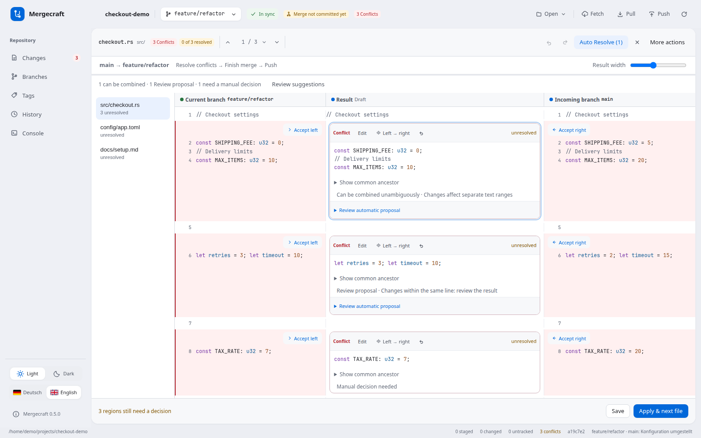

# Resolving a merge

The header shows incoming branch → current branch. The current branch is on the left, the editable result in the middle, and incoming changes on the right. Result width adjusts the columns.

The file list retains decisions, text, scroll position and undo history while switching unresolved files. Drafts live in memory for the current repository/HEAD; leaving the editor warns about unsaved drafts. Resolved files remain visible as completed items.

Auto Resolve previews combinations of separate text ranges. Same-line combinations require explicit individual review. Neither guarantees logically correct code. Overlaps, competing insertions and ambiguous ranges remain manual. Large regions are analyzed in a background worker.

Use the arrow on either source pane to take that version. Expand **Show common ancestor** under the result to see the original lines. **F7** and **Shift+F7** move to the next or previous open conflict in file order.

In the Auto Resolve preview, uncheck any range you want to leave open. Adjacent replacements of distinct, uniquely located lines can appear together in this list. **Review suggestions** opens the next individual preview. For Java and TypeScript/JavaScript, concurrent insertions consisting solely of simple named imports with distinct local names can be previewed left first, then right. Check import order before accepting. Conflicting names, wildcard and side-effect imports require a manual choice.

Left → right concatenates both versions in that order. Undo reverses a complete Auto Resolve batch. More actions contains whole-file choices, reset and abort. Apply & next file writes and stages the result as resolved. Save preserves a partial result. Stale file or index inputs are rejected on save. Reopen a conflict to reload; replacing a stale unsaved draft requires an explicit decision.

Finish merge creates the merge commit. Push transfers committed changes to the remote. Errors remain visible at the relevant step. Abort merge applies only to a running merge, including already saved resolutions; it does not undo a completed merge commit.
